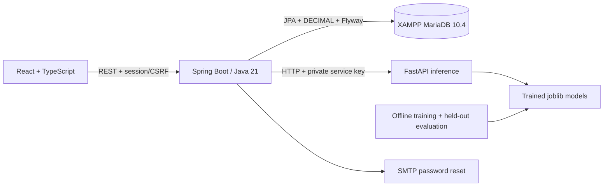

# Kiến trúc FinSight AI

Frontend không gọi AI trực tiếp. `services/api.ts` giữ CSRF token trong memory, gửi cookie same-origin; Vite/nginx proxy `/api`. Backend quyết định quyền và nghiệp vụ; entity owner luôn lấy từ principal, không tin userId từ request. Không có token ở localStorage. Cookie HttpOnly, SameSite=Lax, Secure qua cấu hình HTTPS.

Backend sử dụng Spring Data JPA UserRepository cho authentication và EntityManager cho nghiệp vụ nhiều bảng. Các entity tập trung trong model/Entities, module auth/security/transaction/analytics/ai/config. FinanceService là biên transaction chung để tránh tách chuyển ví, cập nhật số dư, budgets, audit thành các transaction không nhất quán. Phiên bản đầu ưu tiên nguyên tử và dễ kiểm chứng; không tách thành microservice tài chính nhỏ.

Mọi mutation tài chính khóa hàng users của tài khoản trước rồi khóa wallet. Thứ tự khóa ví theo ID khi chuyển tiền. Số tiền là BigDecimal/DECIMAL; không có FLOAT trong ledger. Transfer lưu riêng, không đi vào thu/chi. Idempotency-Key riêng theo user cho transaction/transfer; payload khác cùng key trả 409. CSV import một transaction, file lỗi rollback toàn bộ.

Tiết kiệm là khoản dành riêng: đóng góp trừ ví và tạo contribution; net assets = wallet balances + contributions. Xóa goal hoàn lại ví gốc. Không tự đóng góp từ AI. Wallet archival giữ lịch sử, yêu cầu số dư 0 và không có lịch định kỳ hoạt động.

Budgets tổng hợp giao dịch theo khoảng [đầu tháng, đầu tháng sau), thông báo có unique dedup key theo budget/ngưỡng. Giao dịch sửa/xóa đảo số dư và đánh dấu predictions stale; lịch sử dự báo giữ lại. Cảnh báo của giao dịch chỉnh sửa bị xóa để phân tích lại.

FastAPI load models một lần tại startup, không train trong request. Request cần service key. Lỗi kết nối/timeouts trả 503 có thông báo rõ; wallet/transaction APIs không phụ thuộc AI. Model metric là synthetic benchmark, không phải accuracy tài khoản thật.

SessionTracker quản lý phiên trong memory; phù hợp một backend localhost. Restart đăng xuất mọi phiên. Scaling nhiều node cần Spring Session Redis/JDBC và rate limiter chia sẻ, chưa được kiểm chứng ở bản này.

Demo seeding endpoint chỉ bật khi DEMO_ENABLED=true và tài khoản demoNN@finsight.local. Seed dùng khác seed ML. SMTP localhost là hộp thư thật nhận mail, không relay ra Internet; production dùng SMTP riêng, TLS và COOKIE_SECURE=true.

## Đồng thời và transaction snapshot đã kiểm chứng

Hai CSV 200 dòng đồng thời trên MySQL 8.4 từng tạo đủ 400 dòng nhưng số dư chỉ trừ 200 do consistent-read snapshot được tạo từ truy vấn authentication trước khi chờ user lock. H2 mặc định READ_COMMITTED không tái hiện lỗi. Đã đặt READ_COMMITTED cho transaction CSV/AI/demo có truy vấn auth trước lock; CSV rollback cả checked exceptions. Financial service vẫn khóa user rồi wallet; các query sau khóa dùng dữ liệu đã commit hiện hành. Tài khoản profile/password/reset dùng pessimistic refresh, lock user trước reset token để tránh mất cập nhật mật khẩu và giữ thứ tự khóa. Login cũng tuần tự với đổi mật khẩu.

Bằng chứng trước/sau: docs/test-results/csv-concurrency-before-fix.json và csv-concurrency.json. Kết quả đúng: 400 giao dịch, số dư 4600 từ 5000.
