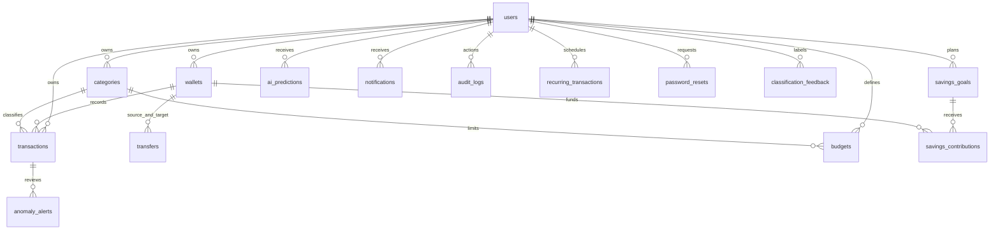

# Database — XAMPP MariaDB / Flyway

Database hiện tại là `finsight` trên XAMPP MariaDB 10.4.28, cổng3306. Đã chuyển từ Docker MySQL8.4 và đối chiếu số dòng/SHA-256 của cả17 bảng ở UTC trước khi bật ứng dụng. Collation đổi sang utf8mb4_unicode_ci; schema và Flyway V1/V2 giữ nguyên. Xem [XAMPP_MIGRATION](XAMPP_MIGRATION.md). Các bằng chứng MySQL bên dưới mô tả kiểm thử trước khi chuyển.

Canonical schema is `backend/src/main/resources/db/migration/`. V1 initializes 16 tables; V2 adds updated_at, backfilling from actual created_at. Migrations already applied must not be edited or regenerated. `database/schema.sql` is the V1 reference, not a replacement for Flyway.

| Table | Principal fields | Constraints |
|---|---|---|
| users | email,password_hash,name,theme | unique email; hash hidden from JSON |
| wallets | user_id,name,type,balance,archived | balance DECIMAL(19,2), >=0 |
| categories | user_id,name | unique(user_id,name) |
| transactions | wallet_id,category_id,type,amount,description,occurred_at,key,recurring_id | amount>0, allowed type; unique(user,key); user/date index |
| transfers | from_wallet_id,to_wallet_id,amount,note,key | amount>0, two FKs, unique(user,key) |
| budgets | category_id,month,amount | amount>0, unique(user,category,month) |
| savings_goals | name,target_amount,due_date | target>0 |
| savings_contributions | goal_id,wallet_id,amount,note | amount>0; refund source preserved |
| ai_predictions | model_version,payload,stale | JSON text contains inference facts/version |
| anomaly_alerts | transaction_id,score,severity,reason,status,model_version | unique(user,transaction), no fraud assertion |
| model_versions | version,metadata | unique version, global nonpersonal model evaluation |
| notifications | dedup_key,message,read_flag | unique(user,dedup_key) |
| audit_logs | action,entity_type,entity_id | Financial mutations recorded |
| recurring_transactions | wallet_id,category_id,type,amount,next_date,interval_days,enabled | idempotent generated transaction keys |
| password_resets | token_hash,expires_at,used | SHA256 hash only; single use |
| classification_feedback | description,category_id | Scoped input for future offline retraining |

Every entity has bigint auto-increment id, created_at and updated_at. Every user-owned table has user_id FK and user index. Referenced financial entities have real foreign keys. Money fields always DECIMAL(19,2); anomaly score uses DOUBLE because it is a statistical score, not money.

JPA ownership checks validate every referenced entity. DB FKs alone do not prove same-owner relationships; FinanceService explicitly requires matching userId. Pessimistic user/wallet locks prevent overspending races. MySQL transaction rollback protects transfer/CSV/account deletion. Transfer has no income/expense transaction rows. Initial wallet balance is opening capital, not monthly income.

Wallets archived instead of deleting referenced history. Goal deletion refunds contributions; wallets funding outstanding contributions cannot be archived, to avoid refunding money into a hidden wallet. Account deletion removes children in FK order and invalidates sessions.

Date boundaries use local Vietnam calendar and exclusive upper bound. Money remains precise in Java/SQL; frontend charts and spreadsheet numeric cells use JS/Excel numbers for display, so extremely large amounts can exceed exact display precision. API validates 15 integer digits and 2 decimals. This prototype is for personal-finance research, not a bank ledger.

## Đồng thời và transaction snapshot đã kiểm chứng

Hai CSV 200 dòng đồng thời trên MySQL 8.4 từng tạo đủ 400 dòng nhưng số dư chỉ trừ 200 do consistent-read snapshot được tạo từ truy vấn authentication trước khi chờ user lock. H2 mặc định READ_COMMITTED không tái hiện lỗi. Đã đặt READ_COMMITTED cho transaction CSV/AI/demo có truy vấn auth trước lock; CSV rollback cả checked exceptions. Financial service vẫn khóa user rồi wallet; các query sau khóa dùng dữ liệu đã commit hiện hành. Tài khoản profile/password/reset dùng pessimistic refresh, lock user trước reset token để tránh mất cập nhật mật khẩu và giữ thứ tự khóa. Login cũng tuần tự với đổi mật khẩu.

Bằng chứng trước/sau: docs/test-results/csv-concurrency-before-fix.json và csv-concurrency.json. Kết quả đúng: 400 giao dịch, số dư 4600 từ 5000.
